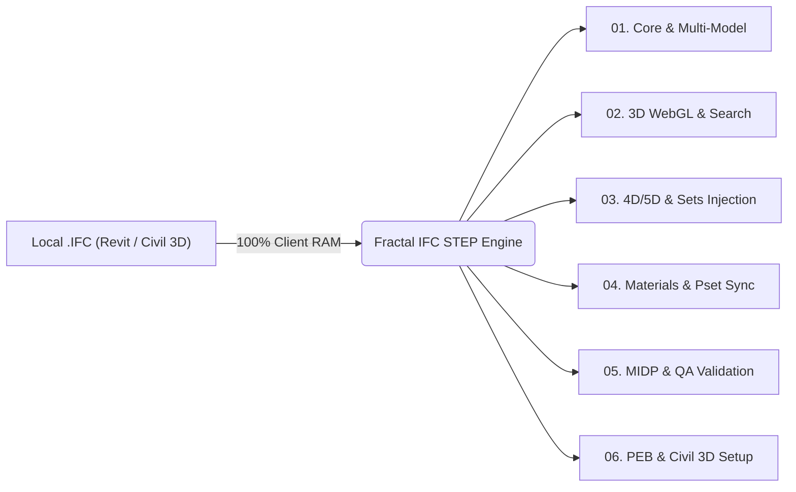

# Fractal IFC Hub — 25 Standalone OpenBIM Tools Suite

A modular collection of **25 OpenBIM & IFC tools** (IFC2x3, IFC4, IFC4x3) designed for auditing, 3D WebGL inspection, metadata injection, Navisworks Selection Sets generation, and QA validation across **Autodesk Revit** and **Civil 3D** models.

---

## 📁 Modular Tool Directory (Standalone Suites)

Just like our Dynamo/Python suites, **each of the 25 tools is isolated in its own self-contained folder** inside [`tools/`](tools/) with its own architecture diagram (`README.md`), standalone client-side IFC STEP engine (`standalone_tool.js`), React UI (`ui_component.tsx`), and Python processor (`python_processor.py`), making it effortless to inspect or pass any single tool to an AI assistant:

| Tool Name | Code | Category | Standalone Folder |
| :--- | :--- | :--- | :--- |
| **Dashboard General de Proyecto** | `Dashboard` | `01-Core-Management` | [`tools/01-Core-Management/DashboardGeneral`](tools/01-Core-Management/DashboardGeneral) |
| **Centro de Mando de Modelos** | `Models` | `01-Core-Management` | [`tools/01-Core-Management/ModelsCommandCenter`](tools/01-Core-Management/ModelsCommandCenter) |
| **Visor 3D IFC Web Interactivo** | `Viewer 3D` | `02-Explore-3D` | [`tools/02-Explore-3D/WebGLViewer3D`](tools/02-Explore-3D/WebGLViewer3D) |
| **Estructura Espacial IFC** | `Structure` | `02-Explore-3D` | [`tools/02-Explore-3D/SpatialStructureInspector`](tools/02-Explore-3D/SpatialStructureInspector) |
| **Árbol Dinámico con Lazy-Loading** | `Dynamic Tree` | `02-Explore-3D` | [`tools/02-Explore-3D/SpatialHierarchyTree`](tools/02-Explore-3D/SpatialHierarchyTree) |
| **Buscador Universal de Valores y Edición Masiva** | `Value Search` | `02-Explore-3D` | [`tools/02-Explore-3D/IfcValueSearchEditor`](tools/02-Explore-3D/IfcValueSearchEditor) |
| **Inyector de Parámetros de Proyecto** | `Project Defaults` | `03-Metadata-Injection` | [`tools/03-Metadata-Injection/ProjectDefaultParamsInjector`](tools/03-Metadata-Injection/ProjectDefaultParamsInjector) |
| **Clasificador IFC Normativo** | `Classifier` | `03-Metadata-Injection` | [`tools/03-Metadata-Injection/SCFClassInjector`](tools/03-Metadata-Injection/SCFClassInjector) |
| **Generador de Conjuntos (IfcSystem)** | `Sets (IfcSystem)` | `03-Metadata-Injection` | [`tools/03-Metadata-Injection/NavisworksSetsInjector`](tools/03-Metadata-Injection/NavisworksSetsInjector) |
| **Conjuntos 4D para Planificación** | `Plan Sets (4D)` | `03-Metadata-Injection` | [`tools/03-Metadata-Injection/Planning4DLinker`](tools/03-Metadata-Injection/Planning4DLinker) |
| **Conjuntos 5D para Presupuesto y Costes** | `Cost Sets (5D)` | `03-Metadata-Injection` | [`tools/03-Metadata-Injection/Costs5DLinker`](tools/03-Metadata-Injection/Costs5DLinker) |
| **Renombrado de Tipo y Objeto ID** | `Name Type ID` | `03-Metadata-Injection` | [`tools/03-Metadata-Injection/NameTypeIdStandardizer`](tools/03-Metadata-Injection/NameTypeIdStandardizer) |
| **Auditoría e Inyección de Metadatos** | `Metadata Manager` | `03-Metadata-Injection` | [`tools/03-Metadata-Injection/StepHeaderMetadataEditor`](tools/03-Metadata-Injection/StepHeaderMetadataEditor) |
| **Gestor de Materiales (Gold Standard)** | `Material Manager` | `04-Data-Materials` | [`tools/04-Data-Materials/MaterialManagerPsetSync`](tools/04-Data-Materials/MaterialManagerPsetSync) |
| **Análisis de Nomenclatura** | `Nomenclature` | `04-Data-Materials` | [`tools/04-Data-Materials/NomenclatureAuditor`](tools/04-Data-Materials/NomenclatureAuditor) |
| **Relación de Parámetros ADIF** | `Rel. Params ADIF` | `04-Data-Materials` | [`tools/04-Data-Materials/Mandatory6ParamsAuditor`](tools/04-Data-Materials/Mandatory6ParamsAuditor) |
| **Validador de Nombres MIDP** | `Name Validator` | `05-Validation-QA` | [`tools/05-Validation-QA/MidpNameValidator`](tools/05-Validation-QA/MidpNameValidator) |
| **Verificador de Calidad QA (Model Checker)** | `Model Checker` | `05-Validation-QA` | [`tools/05-Validation-QA/ModelCheckerQA`](tools/05-Validation-QA/ModelCheckerQA) |
| **Control de Entregas y Exportación** | `Export Control` | `05-Validation-QA` | [`tools/05-Validation-QA/ExportControlAuditor`](tools/05-Validation-QA/ExportControlAuditor) |
| **Detector de Duplicados Geométricos** | `Duplicates` | `05-Validation-QA` | [`tools/05-Validation-QA/GeometricDuplicatesDetector`](tools/05-Validation-QA/GeometricDuplicatesDetector) |
| **Auditoría de Estándares Internacionales** | `Standards Audit` | `05-Validation-QA` | [`tools/05-Validation-QA/IsoOpenBimStandardsAudit`](tools/05-Validation-QA/IsoOpenBimStandardsAudit) |
| **Revisión de Cliente y Aprobaciones** | `Client Review` | `05-Validation-QA` | [`tools/05-Validation-QA/ClientDeliverableReview`](tools/05-Validation-QA/ClientDeliverableReview) |
| **Generador Automático de PEB (.docx)** | `PEB Generator` | `06-Documentation-Config` | [`tools/06-Documentation-Config/BimExecutionPlanGenerator`](tools/06-Documentation-Config/BimExecutionPlanGenerator) |
| **Gestión del Alcance BIM (BIM Scope)** | `BIM Scope` | `06-Documentation-Config` | [`tools/06-Documentation-Config/BimScopeMatrix`](tools/06-Documentation-Config/BimScopeMatrix) |
| **Configuración de Exportación Civil 3D** | `C3D Setup` | `06-Documentation-Config` | [`tools/06-Documentation-Config/Civil3DIfcExportSetup`](tools/06-Documentation-Config/Civil3DIfcExportSetup) |

---

## 📊 Global Architecture

---

## ⚖️ License

Distributed under the **MIT License**. Created by **Julian Mejia** ([@JulianBimDeveloper](https://github.com/JulianBimDeveloper)).
