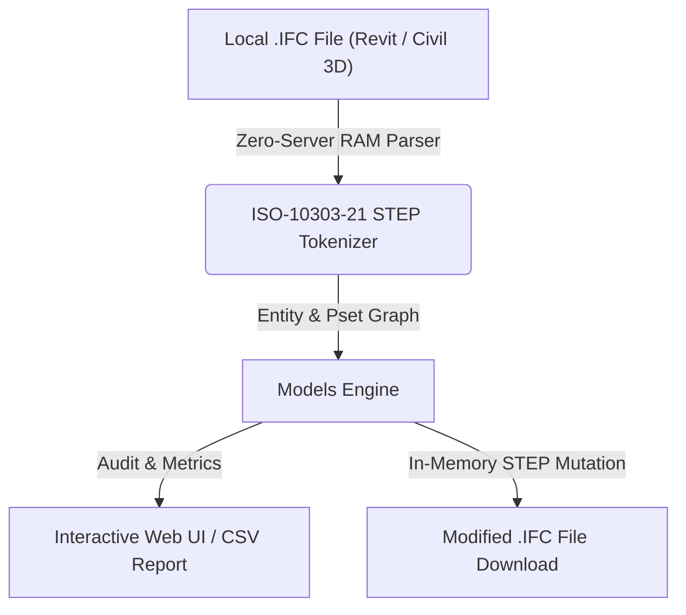

# Centro de Mando de Modelos (`Models`)

> **Standalone OpenBIM & IFC Tool** · `RVT vs C3D` · `Multi-Selección` · `Originating System` · `Zero-Server`

Centro neurálgico de fuentes IFC. Detecta automáticamente el origen del modelo (Autodesk Revit o Civil 3D IfcInfra Plugin) mediante el campo Originating System e IFCAPPLICATION, permitiendo alternar o federar modelos en memoria.

---

## 📊 System Architecture



---

## 📁 Files inside this Standalone Suite

This folder is isolated and self-contained so you (or an AI coding assistant) can inspect, clone, or integrate **Centro de Mando de Modelos** independently:

- **[`standalone_tool.js`](standalone_tool.js)**: Zero-dependency JavaScript IFC STEP engine (runs 100% in browser RAM or Node.js) implementing entity parsing, property inheritance (`IFCRELDEFINESBYTYPE` / `IFCRELDEFINESBYPROPERTIES`), and STEP re-serialization.
- **[`ui_component.tsx`](ui_component.tsx)**: React / Next.js UI implementation for interactive visualization and batch editing.
- **[`python_processor.py`](python_processor.py)**: FastAPI / Python backend module for desktop or server automation.

---

## ✨ Key Capabilities

- Detección automática de autoría: Autodesk Revit vs Civil 3D IfcInfra
- Carga simultánea de múltiples archivos IFC desde tu PC en memoria RAM
- Descarga directa de cualquier modelo modificado en la sesión

---

## 🤖 AI Quick-Build Prompt (Cursor / Claude / ChatGPT)

To replicate or integrate **Centro de Mando de Modelos** into your own application using an AI assistant, share this folder URL and use this prompt:

```text
Build a standalone web/desktop module for "Centro de Mando de Modelos" based on JulianBimDeveloper/ifc-hub-web-app/tree/main/tools/01-Core-Management/ModelsCommandCenter.
Use standalone_tool.js for 100% client-side ISO-10303-21 IFC STEP parsing in RAM (supporting IFC2x3, IFC4, and IFC4x3 from Revit and Civil 3D) and replicate the workflow in ui_component.tsx.
```

---

## ⚖️ License

Distributed under the **MIT License**. Created by **Julian Mejia** ([@JulianBimDeveloper](https://github.com/JulianBimDeveloper)).
