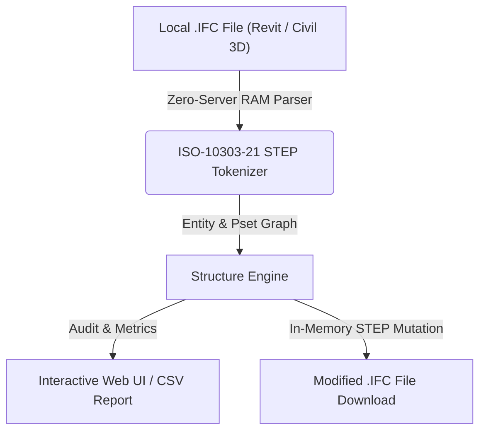

# Estructura Espacial IFC (`Structure`)

> **Standalone OpenBIM & IFC Tool** · `ISO 16739` · `IfcRailwayPart` · `IfcSite` · `Jerarquía`

Desglosa la jerarquía espacial completa del archivo IFC según el estándar ISO 16739 (incluyendo IfcRailway, IfcRailwayPart, IfcFacility e IfcBuildingStorey en IFC 4x3). Excluye contenedores espaciales del conteo de elementos físicos.

---

## 📊 System Architecture



---

## 📁 Files inside this Standalone Suite

This folder is isolated and self-contained so you (or an AI coding assistant) can inspect, clone, or integrate **Estructura Espacial IFC** independently:

- **[`standalone_tool.js`](standalone_tool.js)**: Zero-dependency JavaScript IFC STEP engine (runs 100% in browser RAM or Node.js) implementing entity parsing, property inheritance (`IFCRELDEFINESBYTYPE` / `IFCRELDEFINESBYPROPERTIES`), and STEP re-serialization.
- **[`ui_component.tsx`](ui_component.tsx)**: React / Next.js UI implementation for interactive visualization and batch editing.
- **[`python_processor.py`](python_processor.py)**: FastAPI / Python backend module for desktop or server automation.

---

## ✨ Key Capabilities

- Navegación recursiva por niveles (IfcRailwayPart / IfcBuildingStorey)
- Conteo exacto de elementos físicos excluyendo contenedores espaciales
- Desglose de clases IFC (IfcPipeSegment, IfcDistributionChamberElement, etc.)

---

## 🤖 AI Quick-Build Prompt (Cursor / Claude / ChatGPT)

To replicate or integrate **Estructura Espacial IFC** into your own application using an AI assistant, share this folder URL and use this prompt:

```text
Build a standalone web/desktop module for "Estructura Espacial IFC" based on JulianBimDeveloper/ifc-hub-web-app/tree/main/tools/02-Explore-3D/SpatialStructureInspector.
Use standalone_tool.js for 100% client-side ISO-10303-21 IFC STEP parsing in RAM (supporting IFC2x3, IFC4, and IFC4x3 from Revit and Civil 3D) and replicate the workflow in ui_component.tsx.
```

---

## ⚖️ License

Distributed under the **MIT License**. Created by **Julian Mejia** ([@JulianBimDeveloper](https://github.com/JulianBimDeveloper)).
