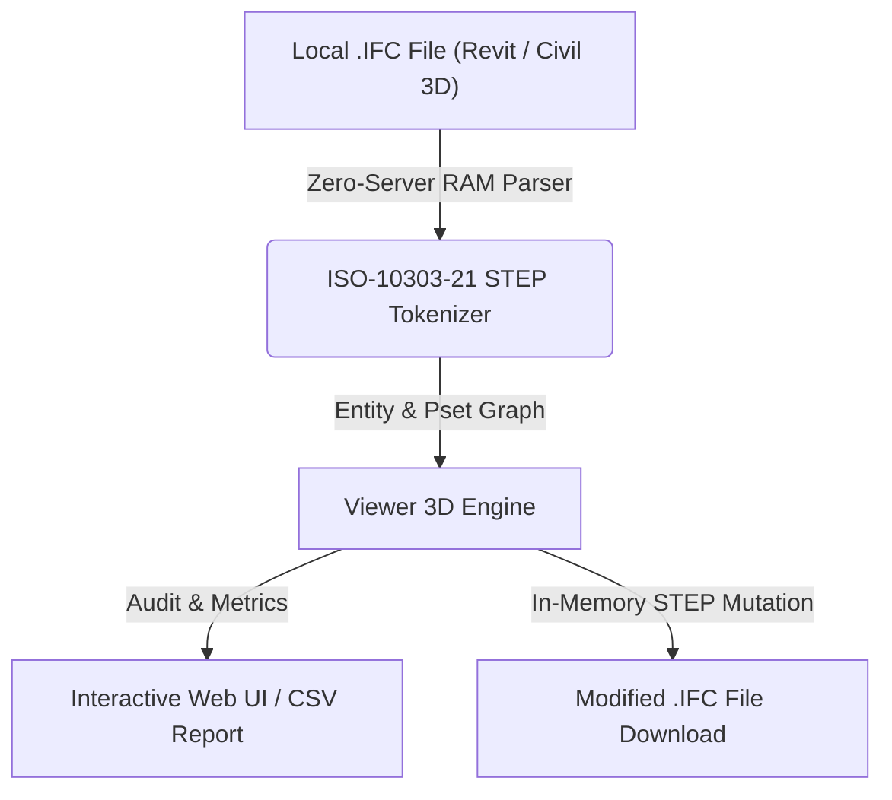

# Visor 3D IFC Web Interactivo (`Viewer 3D`)

> **Standalone OpenBIM & IFC Tool** · `WebGL` · `Three.js` · `SweptSolid & Tessellation` · `3D Interactivo`

Visor 3D acelerado por WebGL para modelos de infraestructura (Civil 3D IfcTriangulatedFaceSet) y edificación/instalaciones (Revit IfcExtrudedAreaSolid / IfcMappedItem / IfcFacetedBrep) con coordenadas UTM ETRS89 centradas automáticamente.

---

## 📊 System Architecture



---

## 📁 Files inside this Standalone Suite

This folder is isolated and self-contained so you (or an AI coding assistant) can inspect, clone, or integrate **Visor 3D IFC Web Interactivo** independently:

- **[`standalone_tool.js`](standalone_tool.js)**: Zero-dependency JavaScript IFC STEP engine (runs 100% in browser RAM or Node.js) implementing entity parsing, property inheritance (`IFCRELDEFINESBYTYPE` / `IFCRELDEFINESBYPROPERTIES`), and STEP re-serialization.
- **[`ui_component.tsx`](ui_component.tsx)**: React / Next.js UI implementation for interactive visualization and batch editing.
- **[`python_processor.py`](python_processor.py)**: FastAPI / Python backend module for desktop or server automation.

---

## ✨ Key Capabilities

- Renderizado de geometría real IFC 4x3 (IfcExtrudedAreaSolid, IfcTriangulatedFaceSet, IfcFacetedBrep)
- Inspección de Property Sets (ADIF_00..08, INGR, Tipo heredado) al hacer clic
- Resolución de matriz completa IfcLocalPlacement en coordenadas UTM ETRS89
- Filtro de visibilidad por clases IFC, capas y disciplinas

---

## 🤖 AI Quick-Build Prompt (Cursor / Claude / ChatGPT)

To replicate or integrate **Visor 3D IFC Web Interactivo** into your own application using an AI assistant, share this folder URL and use this prompt:

```text
Build a standalone web/desktop module for "Visor 3D IFC Web Interactivo" based on JulianBimDeveloper/ifc-hub-web-app/tree/main/tools/02-Explore-3D/WebGLViewer3D.
Use standalone_tool.js for 100% client-side ISO-10303-21 IFC STEP parsing in RAM (supporting IFC2x3, IFC4, and IFC4x3 from Revit and Civil 3D) and replicate the workflow in ui_component.tsx.
```

---

## ⚖️ License

Distributed under the **MIT License**. Created by **Julian Mejia** ([@JulianBimDeveloper](https://github.com/JulianBimDeveloper)).
