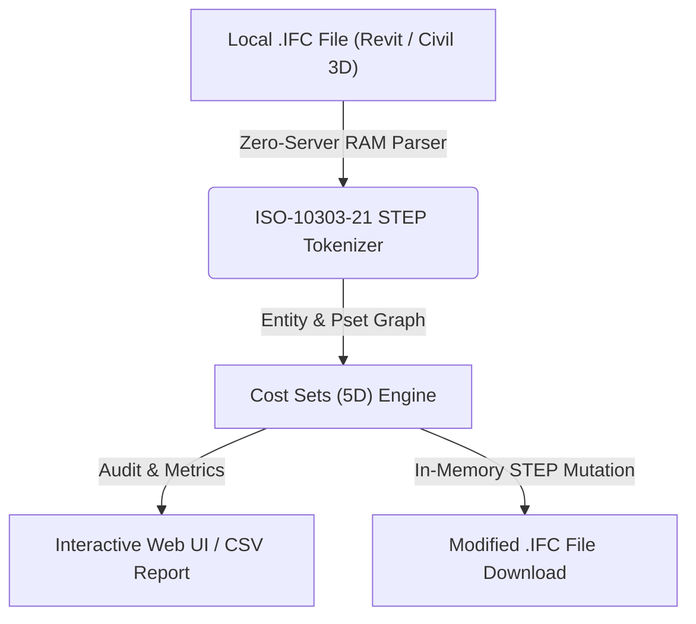

# Conjuntos 5D para Presupuesto y Costes (`Cost Sets (5D)`)

> **Standalone OpenBIM & IFC Tool** · `5D BIM` · `Costes` · `ADIF_05_5D` · `Mediciones`

Organiza los elementos según su partida presupuestaria (ADIF_05_5D / ADIF_05_Codigo_Partida / INGR_Importe_Total), calcula mediciones geométricas reales (metros lineales de tubería, unidades de arquetas) y permite asignar partidas masivamente.

---

## 📊 System Architecture



---

## 📁 Files inside this Standalone Suite

This folder is isolated and self-contained so you (or an AI coding assistant) can inspect, clone, or integrate **Conjuntos 5D para Presupuesto y Costes** independently:

- **[`standalone_tool.js`](standalone_tool.js)**: Zero-dependency JavaScript IFC STEP engine (runs 100% in browser RAM or Node.js) implementing entity parsing, property inheritance (`IFCRELDEFINESBYTYPE` / `IFCRELDEFINESBYPROPERTIES`), and STEP re-serialization.
- **[`ui_component.tsx`](ui_component.tsx)**: React / Next.js UI implementation for interactive visualization and batch editing.
- **[`python_processor.py`](python_processor.py)**: FastAPI / Python backend module for desktop or server automation.

---

## ✨ Key Capabilities

- Cálculo automático de longitud total (m), área y unidades por partida
- Asignación e inyección de ADIF_05_Codigo_Partida en elementos con 'N/A'
- Inyección de conjuntos 5D (IfcSystem) y exportación de cuadro de mediciones CSV

---

## 🤖 AI Quick-Build Prompt (Cursor / Claude / ChatGPT)

To replicate or integrate **Conjuntos 5D para Presupuesto y Costes** into your own application using an AI assistant, share this folder URL and use this prompt:

```text
Build a standalone web/desktop module for "Conjuntos 5D para Presupuesto y Costes" based on JulianBimDeveloper/ifc-hub-web-app/tree/main/tools/03-Metadata-Injection/Costs5DLinker.
Use standalone_tool.js for 100% client-side ISO-10303-21 IFC STEP parsing in RAM (supporting IFC2x3, IFC4, and IFC4x3 from Revit and Civil 3D) and replicate the workflow in ui_component.tsx.
```

---

## ⚖️ License

Distributed under the **MIT License**. Created by **Julian Mejia** ([@JulianBimDeveloper](https://github.com/JulianBimDeveloper)).
