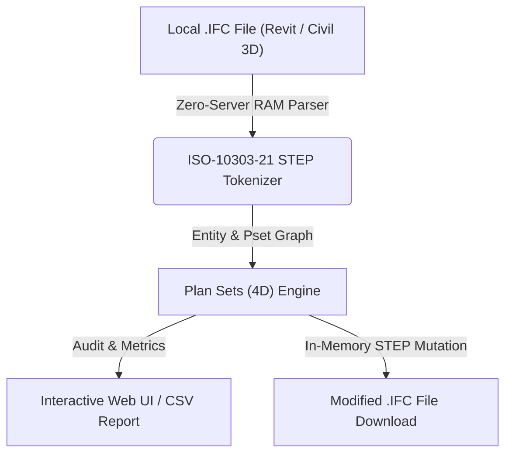

# Conjuntos 4D para Planificación (`Plan Sets (4D)`)

> **Standalone OpenBIM & IFC Tool** · `4D BIM` · `TimeLiner` · `ADIF_04_4D` · `Planificación`

Prepara el modelo para TimeLiner de Navisworks, MS Project o Primavera P6. Analiza ADIF_04_4D e INGR (ADIF_04_Codigo_Actividad, ADIF_04_Fase, ADIF_04_Inicio_Actividad, INGR_Inicio_Planeado, INGR_Fin_Planeado) e inyecta códigos 4D.

---

## 📊 System Architecture



---

## 📁 Files inside this Standalone Suite

This folder is isolated and self-contained so you (or an AI coding assistant) can inspect, clone, or integrate **Conjuntos 4D para Planificación** independently:

- **[`standalone_tool.js`](standalone_tool.js)**: Zero-dependency JavaScript IFC STEP engine (runs 100% in browser RAM or Node.js) implementing entity parsing, property inheritance (`IFCRELDEFINESBYTYPE` / `IFCRELDEFINESBYPROPERTIES`), and STEP re-serialization.
- **[`ui_component.tsx`](ui_component.tsx)**: React / Next.js UI implementation for interactive visualization and batch editing.
- **[`python_processor.py`](python_processor.py)**: FastAPI / Python backend module for desktop or server automation.

---

## ✨ Key Capabilities

- Auditoría de parámetros ADIF_04_Codigo_Actividad, Fase e Inicio/Fin Planeado
- Asignación masiva de actividades del cronograma por tipo o producto ADIF
- Inyección de conjuntos 4D (IfcSystem) y exportación CSV para TimeLiner

---

## 🤖 AI Quick-Build Prompt (Cursor / Claude / ChatGPT)

To replicate or integrate **Conjuntos 4D para Planificación** into your own application using an AI assistant, share this folder URL and use this prompt:

```text
Build a standalone web/desktop module for "Conjuntos 4D para Planificación" based on JulianBimDeveloper/ifc-hub-web-app/tree/main/tools/03-Metadata-Injection/Planning4DLinker.
Use standalone_tool.js for 100% client-side ISO-10303-21 IFC STEP parsing in RAM (supporting IFC2x3, IFC4, and IFC4x3 from Revit and Civil 3D) and replicate the workflow in ui_component.tsx.
```

---

## ⚖️ License

Distributed under the **MIT License**. Created by **Julian Mejia** ([@JulianBimDeveloper](https://github.com/JulianBimDeveloper)).
