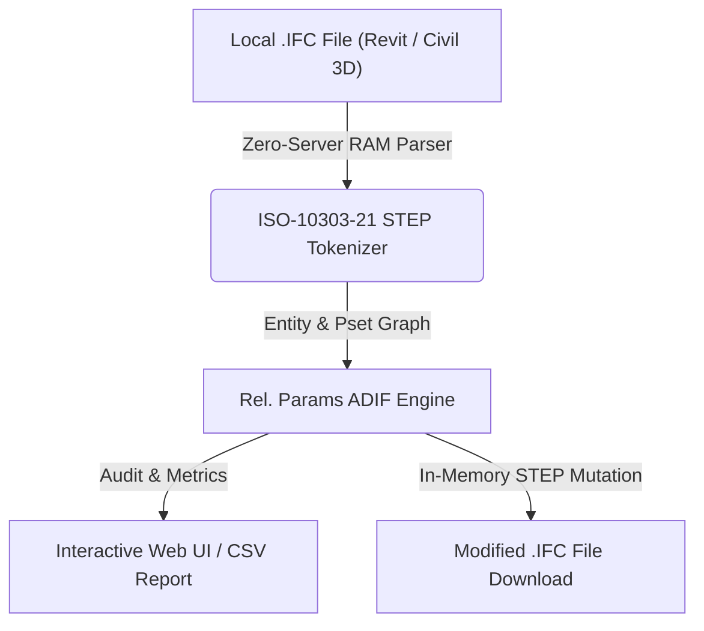

# Relación de Parámetros ADIF (`Rel. Params ADIF`)

> **Standalone OpenBIM & IFC Tool** · `ADIF Mandato` · `6 Parámetros` · `N/A Detection` · `Visibilidad Temporal`

Audita elemento por elemento los 6 parámetros obligatorios ADIF (ADIF_00_Codigo_Producto, ADIF_02_Zonificacion, ADIF_03_Codigo_Estado, ADIF_03_Fuente_Definicion, ADIF_04_Codigo_Actividad y ADIF_05_Codigo_Partida) considerando 'N/A' como vacío.

---

## 📊 System Architecture



---

## 📁 Files inside this Standalone Suite

This folder is isolated and self-contained so you (or an AI coding assistant) can inspect, clone, or integrate **Relación de Parámetros ADIF** independently:

- **[`standalone_tool.js`](standalone_tool.js)**: Zero-dependency JavaScript IFC STEP engine (runs 100% in browser RAM or Node.js) implementing entity parsing, property inheritance (`IFCRELDEFINESBYTYPE` / `IFCRELDEFINESBYPROPERTIES`), and STEP re-serialization.
- **[`ui_component.tsx`](ui_component.tsx)**: React / Next.js UI implementation for interactive visualization and batch editing.
- **[`python_processor.py`](python_processor.py)**: FastAPI / Python backend module for desktop or server automation.

---

## ✨ Key Capabilities

- Cálculo exacto de completitud de los 6 parámetros obligatorios ADIF (tratando 'N/A' como vacío)
- Verificación de coherencia entre ADIF_03_Codigo_Estado, Descripcion_Estado y Visibilidad_Temporal
- Autocompletado asistido de parámetros faltantes y descarga del IFC corregido

---

## 🤖 AI Quick-Build Prompt (Cursor / Claude / ChatGPT)

To replicate or integrate **Relación de Parámetros ADIF** into your own application using an AI assistant, share this folder URL and use this prompt:

```text
Build a standalone web/desktop module for "Relación de Parámetros ADIF" based on JulianBimDeveloper/ifc-hub-web-app/tree/main/tools/04-Data-Materials/Mandatory6ParamsAuditor.
Use standalone_tool.js for 100% client-side ISO-10303-21 IFC STEP parsing in RAM (supporting IFC2x3, IFC4, and IFC4x3 from Revit and Civil 3D) and replicate the workflow in ui_component.tsx.
```

---

## ⚖️ License

Distributed under the **MIT License**. Created by **Julian Mejia** ([@JulianBimDeveloper](https://github.com/JulianBimDeveloper)).
