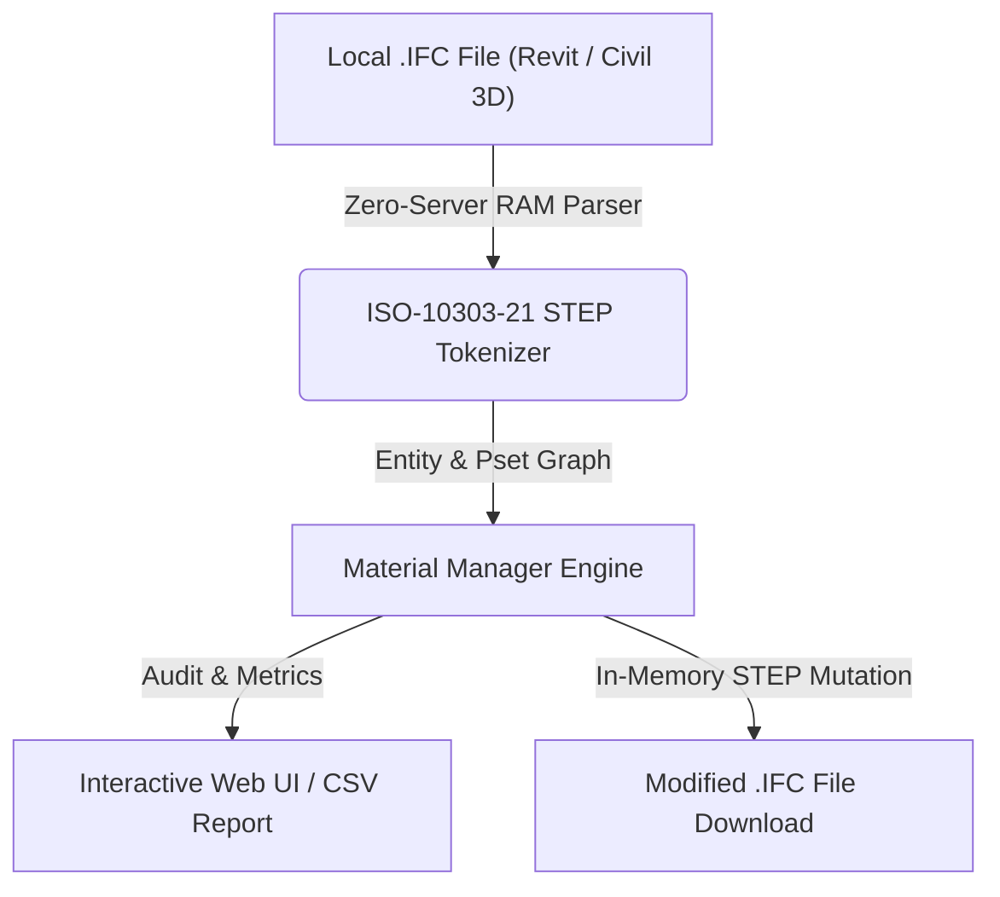

# Gestor de Materiales (Gold Standard) (`Material Manager`)

> **Standalone OpenBIM & IFC Tool** · `IfcMaterial` · `Herencia por Tipo` · `Renombrado` · `Sincronización Pset`

Resuelve materiales asignados directamente o heredados por tipo (IfcRelDefinesByType -> IfcRelAssociatesMaterial), permite renombrar cualquier IfcMaterial (ej. corregir 'N/A' o '<Unnamed>') y sincronizar el material hacia un Property Set.

---

## 📊 System Architecture



---

## 📁 Files inside this Standalone Suite

This folder is isolated and self-contained so you (or an AI coding assistant) can inspect, clone, or integrate **Gestor de Materiales (Gold Standard)** independently:

- **[`standalone_tool.js`](standalone_tool.js)**: Zero-dependency JavaScript IFC STEP engine (runs 100% in browser RAM or Node.js) implementing entity parsing, property inheritance (`IFCRELDEFINESBYTYPE` / `IFCRELDEFINESBYPROPERTIES`), and STEP re-serialization.
- **[`ui_component.tsx`](ui_component.tsx)**: React / Next.js UI implementation for interactive visualization and batch editing.
- **[`python_processor.py`](python_processor.py)**: FastAPI / Python backend module for desktop or server automation.

---

## ✨ Key Capabilities

- Resolución completa de materiales por instancia, por Tipo (IfcPipeSegmentType) y constituyentes
- Renombrado directo de entidades IFCMATERIAL en memoria (ej. corregir 'N/A' en Civil 3D)
- Sincronización masiva del nombre de material hacia Property Sets en el IFC

---

## 🤖 AI Quick-Build Prompt (Cursor / Claude / ChatGPT)

To replicate or integrate **Gestor de Materiales (Gold Standard)** into your own application using an AI assistant, share this folder URL and use this prompt:

```text
Build a standalone web/desktop module for "Gestor de Materiales (Gold Standard)" based on JulianBimDeveloper/ifc-hub-web-app/tree/main/tools/04-Data-Materials/MaterialManagerPsetSync.
Use standalone_tool.js for 100% client-side ISO-10303-21 IFC STEP parsing in RAM (supporting IFC2x3, IFC4, and IFC4x3 from Revit and Civil 3D) and replicate the workflow in ui_component.tsx.
```

---

## ⚖️ License

Distributed under the **MIT License**. Created by **Julian Mejia** ([@JulianBimDeveloper](https://github.com/JulianBimDeveloper)).
