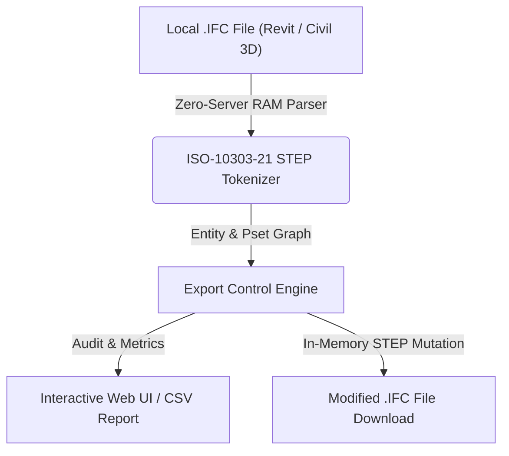

# Control de Entregas y Exportación (`Export Control`)

> **Standalone OpenBIM & IFC Tool** · `CDE` · `Entregables` · `SHA-256` · `Control Hitos`

Verifica que cada archivo IFC del paquete de entrega cumpla con los requisitos del hito contractual: huella digital SHA-256 en navegador, timestamp ISO de FILE_NAME, coincidencia con ADIF_00_Codigo_Archivo y estado de preparación.

---

## 📊 System Architecture



---

## 📁 Files inside this Standalone Suite

This folder is isolated and self-contained so you (or an AI coding assistant) can inspect, clone, or integrate **Control de Entregas y Exportación** independently:

- **[`standalone_tool.js`](standalone_tool.js)**: Zero-dependency JavaScript IFC STEP engine (runs 100% in browser RAM or Node.js) implementing entity parsing, property inheritance (`IFCRELDEFINESBYTYPE` / `IFCRELDEFINESBYPROPERTIES`), and STEP re-serialization.
- **[`ui_component.tsx`](ui_component.tsx)**: React / Next.js UI implementation for interactive visualization and batch editing.
- **[`python_processor.py`](python_processor.py)**: FastAPI / Python backend module for desktop or server automation.

---

## ✨ Key Capabilities

- Cálculo de hash criptográfico SHA-256 de cada archivo IFC en el navegador
- Verificación de trazabilidad entre nombre del IFC y ADIF_00_Codigo_Archivo (.rvt / .dwg)
- Semáforo de aptitud de entrega para el CDE (Autodesk Construction Cloud / ProjectWise)

---

## 🤖 AI Quick-Build Prompt (Cursor / Claude / ChatGPT)

To replicate or integrate **Control de Entregas y Exportación** into your own application using an AI assistant, share this folder URL and use this prompt:

```text
Build a standalone web/desktop module for "Control de Entregas y Exportación" based on JulianBimDeveloper/ifc-hub-web-app/tree/main/tools/05-Validation-QA/ExportControlAuditor.
Use standalone_tool.js for 100% client-side ISO-10303-21 IFC STEP parsing in RAM (supporting IFC2x3, IFC4, and IFC4x3 from Revit and Civil 3D) and replicate the workflow in ui_component.tsx.
```

---

## ⚖️ License

Distributed under the **MIT License**. Created by **Julian Mejia** ([@JulianBimDeveloper](https://github.com/JulianBimDeveloper)).
