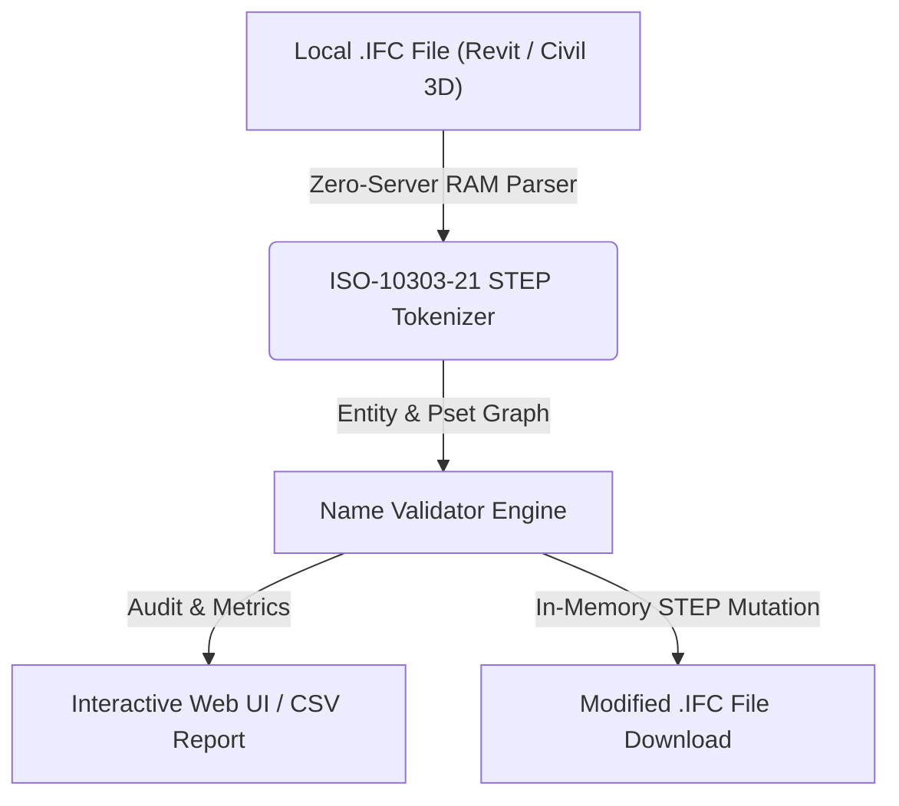

# Validador de Nombres MIDP (`Name Validator`)

> **Standalone OpenBIM & IFC Tool** · `MIDP` · `ISO 19650` · `8 Campos ADIF` · `Validador`

Valida la estructura de codificación del fichero IFC (Expediente-Origen-Fase-Nivel-Disciplina-Secuencia-Actuación_Tipo_Descripción_Software.ifc) tanto para los archivos cargados como para cualquier código introducido.

---

## 📊 System Architecture



---

## 📁 Files inside this Standalone Suite

This folder is isolated and self-contained so you (or an AI coding assistant) can inspect, clone, or integrate **Validador de Nombres MIDP** independently:

- **[`standalone_tool.js`](standalone_tool.js)**: Zero-dependency JavaScript IFC STEP engine (runs 100% in browser RAM or Node.js) implementing entity parsing, property inheritance (`IFCRELDEFINESBYTYPE` / `IFCRELDEFINESBYPROPERTIES`), and STEP re-serialization.
- **[`ui_component.tsx`](ui_component.tsx)**: React / Next.js UI implementation for interactive visualization and batch editing.
- **[`python_processor.py`](python_processor.py)**: FastAPI / Python backend module for desktop or server automation.

---

## ✨ Key Capabilities

- Desglose automático bloque a bloque de todos los IFC cargados en la sesión
- Verificación cruzada entre sufijo del nombre (_RVT / _C3D) y Originating System real
- Constructor y corrector interactivo de nombres MIDP

---

## 🤖 AI Quick-Build Prompt (Cursor / Claude / ChatGPT)

To replicate or integrate **Validador de Nombres MIDP** into your own application using an AI assistant, share this folder URL and use this prompt:

```text
Build a standalone web/desktop module for "Validador de Nombres MIDP" based on JulianBimDeveloper/ifc-hub-web-app/tree/main/tools/05-Validation-QA/MidpNameValidator.
Use standalone_tool.js for 100% client-side ISO-10303-21 IFC STEP parsing in RAM (supporting IFC2x3, IFC4, and IFC4x3 from Revit and Civil 3D) and replicate the workflow in ui_component.tsx.
```

---

## ⚖️ License

Distributed under the **MIT License**. Created by **Julian Mejia** ([@JulianBimDeveloper](https://github.com/JulianBimDeveloper)).
